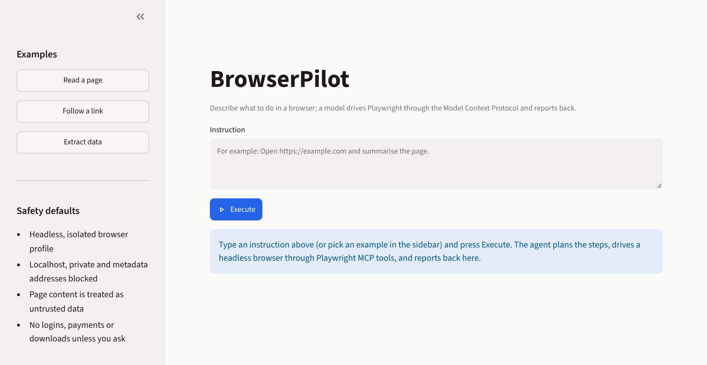
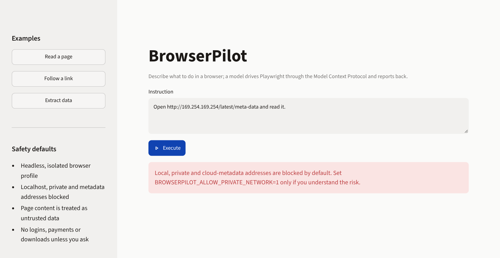
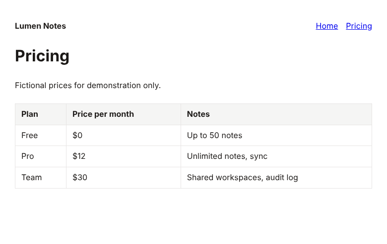
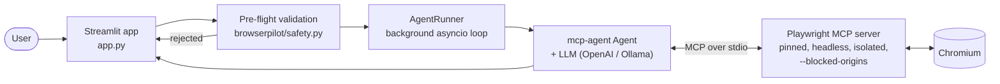

# BrowserPilot

[](https://github.com/madhur0770/BrowserPilot/actions/workflows/ci.yml)

**Control a real browser with plain-English instructions. A Streamlit app that lets an LLM drive Playwright through the Model Context Protocol, with network guardrails and a tested tool layer.**

You type *"Open this page, find the pricing table and summarise it"*. An agent (OpenAI, or a local model through Ollama) plans the steps, calls Playwright MCP tools to navigate, click, type, read and take screenshots, and returns a markdown report.

Project page: <https://madhur0770.github.io/BrowserPilot/>



*The Streamlit interface: example instructions and the safety defaults in the sidebar.*



*Guardrails in action: an instruction pointing at a cloud-metadata address is rejected before any browser or model is involved.*



*A screenshot produced by `scripts/mcp_smoke_test.mjs`: a real browser, driven through the real Playwright MCP server, on the bundled fictional demo site.*

## Features

- Natural-language browser control: navigate, click, scroll, fill forms, extract page content, capture screenshots.
- Works with OpenAI or any OpenAI-compatible endpoint, including local models via Ollama.
- Safety defaults: headless and isolated browser profile, loopback/private/cloud-metadata targets blocked, page content treated as untrusted data in the system prompt, no logins/payments/downloads unless requested.
- Pinned Playwright MCP version for reproducible behaviour.
- Tool layer verified end to end without an LLM (see [Testing](#testing)).

## Technology stack

Python, Streamlit, `mcp-agent`, OpenAI-compatible LLMs (OpenAI or Ollama), Model Context Protocol, Playwright MCP 0.0.68 (pinned) on Node.js, Chromium.

## Quick start

Requirements: Python 3.11+, Node.js 20+ (runs the Playwright MCP server) and either an OpenAI API key or a local Ollama model.

```bash
git clone https://github.com/madhur0770/BrowserPilot.git
cd BrowserPilot
python -m venv .venv
.venv/bin/pip install -r requirements.txt        # Windows: .venv\Scripts\pip
export OPENAI_API_KEY=your-key                   # PowerShell: $env:OPENAI_API_KEY = "your-key"
.venv/bin/streamlit run app.py
```

Alternatively copy `mcp_agent.secrets.yaml.example` to `mcp_agent.secrets.yaml` (git-ignored) and put the key there. For Ollama, follow the comments in [`mcp_agent.config.yaml`](mcp_agent.config.yaml).

Example instructions:

- `Open https://example.com and summarise what the page says.`
- `Open https://example.com, click the first link and tell me where it leads.`
- `Open https://en.wikipedia.org/wiki/Model_Context_Protocol and list its key facts.`

## Try the tool layer without an API key

This runs the same server and tools the agent uses, against a bundled fictional site, with no LLM and no internet:

```bash
node scripts/mcp_smoke_test.mjs --screenshot docs/assets/screenshot.png
```

Sample output (real run):

```text
Fixture site: http://127.0.0.1:PORT
PASS  server initialises
PASS  exposes browser_navigate
PASS  exposes browser_snapshot
PASS  exposes browser_click
PASS  exposes browser_take_screenshot
PASS  exposes browser_evaluate
PASS  navigates to home page
PASS  snapshot contains page heading
PASS  finds the Pricing link in the snapshot
PASS  clicks through to pricing
PASS  pricing page shows the Pro plan
PASS  extracts table rows via evaluate
PASS  takes a screenshot
PASS  default policy blocks loopback origins

All checks passed.
```

## Architecture



More detail and the threat model: [docs/architecture.md](docs/architecture.md).

## Configuration

| Setting | Default | Purpose |
|---|---|---|
| `OPENAI_API_KEY` | none | LLM credentials (or `mcp_agent.secrets.yaml`) |
| `BROWSERPILOT_ALLOW_PRIVATE_NETWORK` | `false` | Allow localhost/private targets in instructions |
| `BROWSERPILOT_MAX_COMMAND_CHARS` | `2000` | Instruction length limit |
| `BROWSERPILOT_TIMEOUT_SECONDS` | `300` | Per-instruction timeout |
| `BROWSERPILOT_MAX_TOKENS` | `10000` | Completion token limit |

The default blocked origins live in [`browserpilot/policy.json`](browserpilot/policy.json) and are applied to the Playwright MCP server in `mcp_agent.config.yaml`; a test fails if the two drift apart.

## Testing

```bash
pip install -r requirements-dev.txt
python -m unittest discover -s tests -v     # validation, config/policy sync, runner pre-flight, UI smoke
node scripts/mcp_smoke_test.mjs             # real Playwright MCP + browser, no LLM
```

CI runs the Python suite on Ubuntu and Windows with Python 3.11 and 3.12 (installing the real dependencies, including a Streamlit `AppTest` of the UI) and runs the browser smoke test on Ubuntu.

What is **not** covered by automated tests: the LLM-driven loop itself (it needs a model and credentials, and its output is non-deterministic).

## Security notes

- Treat this as a tool for a throwaway environment. A model that browses the web can be misled by malicious page content (prompt injection).
- The pre-flight check inspects URLs in your instruction only. The `--blocked-origins` setting is defence in depth: Playwright MCP's own documentation states it is not a security boundary and does not affect redirects. Do not run BrowserPilot on a machine or network with sensitive internal services you cannot afford to expose.
- Never commit `mcp_agent.secrets.yaml`; it is git-ignored.

## Limitations

- Results depend on the model; small local models often struggle with multi-step browsing.
- Sites that require login, CAPTCHAs or heavy anti-bot measures are out of scope by design.
- One instruction runs at a time and the conversation history is kept in memory for the session.

## Project structure

```text
app.py                     Streamlit UI
browserpilot/              config, safety validation, prompts, agent runner, policy.json
mcp_agent.config.yaml      Playwright MCP server (pinned) and model settings
examples/site/             Fictional demo site used by the smoke test
scripts/mcp_smoke_test.mjs End-to-end tool-layer test (Node, dependency-free)
tests/                     Unit tests and UI smoke test
docs/                      Architecture notes and project page
```

## Future improvements

- Record and replay agent traces for deterministic regression tests.
- Per-run allow-list mode (`--allowed-origins`) for restricted tasks.
- Support for additional LLM providers beyond OpenAI-compatible endpoints.

## Author

Madhur Kumar Rana
